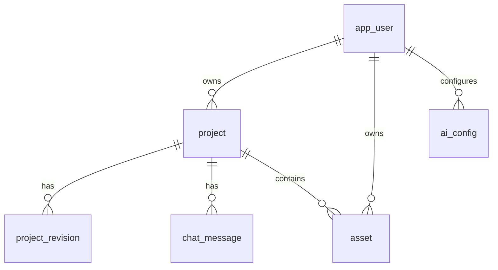

# 10 - 数据库设计与当前状态

> 记录时间：2026-11-12  
> 适用版本：MVP + 用户自带 AI 配置  
> 相关代码：`src/main/resources/db/migration/`、`src/main/resources/application*.yaml`

## 1. 先给结论

**当前项目还没有切换到 PostgreSQL，仍在使用 H2 开发数据库。**

当前实际状态：

| 项目 | 状态 |
| --- | --- |
| 后端运行方式 | IntelliJ IDEA 启动，默认 `dev` profile |
| 当前数据库 | H2 文件库 `./data/webporduce.mv.db` |
| PostgreSQL 服务 | 已安装并运行，服务名 `postgresql-x64-18` |
| PostgreSQL 数据库 | `webporduce` 已创建，`webporduce` 用户可连接 |
| PostgreSQL 表 | `public` schema 当前 **0 张表** |
| 应用数据位置 | H2，不在 PostgreSQL |

也就是说：

- PostgreSQL 已经准备好了，但还没有被应用使用。
- 现在登录、项目、对话、AI 配置等数据都还在 H2 文件里。
- 切换到 PostgreSQL 后，H2 里的账号和项目**不会自动迁移**，需要重新注册，或者单独做数据迁移。

## 2. 数据库配置

### 2.1 开发环境：H2

配置文件：`src/main/resources/application-dev.yaml`

```yaml
spring:
  datasource:
    url: jdbc:h2:file:./data/webporduce;MODE=PostgreSQL;DATABASE_TO_LOWER=TRUE;DEFAULT_NULL_ORDERING=HIGH;AUTO_SERVER=TRUE
    driver-class-name: org.h2.Driver
    username: sa
    password:
  jpa:
    hibernate:
      ddl-auto: validate
  flyway:
    enabled: true
  h2:
    console:
      enabled: true
      path: /h2-console
```

要点：

- H2 使用 `MODE=PostgreSQL`，只是语法兼容模式，不代表数据存进了 PostgreSQL。
- `AUTO_SERVER=TRUE` 允许多个进程连接同一个 H2 文件。
- H2 控制台仅开发环境开启，生产环境必须关闭。
- 数据文件：`./data/webporduce.mv.db`
- 锁文件：`./data/webporduce.lock.db`

### 2.2 生产环境：PostgreSQL

配置文件：`src/main/resources/application-prod.yaml`

```yaml
spring:
  datasource:
    url: ${DB_URL:jdbc:postgresql://localhost:5432/webporduce}
    username: ${DB_USERNAME:webporduce}
    password: ${DB_PASSWORD:webporduce}
    driver-class-name: org.postgresql.Driver
  jpa:
    hibernate:
      ddl-auto: validate
  flyway:
    enabled: true
```

要点：

- `ddl-auto: validate`：Hibernate 只校验表结构，不自动建表。
- 建表由 Flyway 迁移脚本负责。
- 生产环境必须显式设置 `APP_AI_ENCRYPTION_KEY`，否则启动失败。
- Docker Compose 中使用的是 `postgres:16-alpine`；本机安装的是 PostgreSQL 18.4，两者都可以运行当前迁移。

### 2.3 关键环境变量

| 变量 | 作用 | 开发 H2（`dev`） | 本地 PG（`local-postgres`） | 生产（`prod`） |
| --- | --- | --- | --- | --- |
| `SPRING_PROFILES_ACTIVE` | 激活配置 | `dev`（默认） | `local-postgres` | 必须为 `prod` |
| `DB_URL` | JDBC 连接串 | H2 文件地址 | `jdbc:postgresql://localhost:5432/webporduce` | `jdbc:postgresql://localhost:5432/webporduce` |
| `DB_USERNAME` | 数据库用户 | `sa` | `webporduce` | `webporduce` |
| `DB_PASSWORD` | 数据库密码 | 空 | 启动前填写 | 强随机密码 |
| `APP_STORAGE_ROOT` | 上传文件目录 | `./data/uploads` | `./data/uploads` | `/app/uploads` 或本机绝对路径 |
| `APP_AI_ENCRYPTION_KEY` | AI Key 加密密钥 | 可回退开发密钥 | 可回退开发密钥 | 必须显式设置，至少 16 字符 |
| `SESSION_COOKIE_SECURE` | Session Cookie 是否仅 HTTPS | `false` | `false` | HTTPS 下为 `true` |

> 注意：`APP_AI_ENCRYPTION_KEY` 一旦用于保存 API Key，就不要随意更换。更换后旧 Key 将无法解密。

### 2.4 关于 `APP_AI_ENCRYPTION_KEY`

它和用户在「AI 设置」里填的 API Key 不是一回事：

| 配置 | 谁来填 | 作用 |
| --- | --- | --- |
| 用户 AI 配置里的 API Key | 每个用户自己填 | 调用 OpenAI / Anthropic / Gemini / Agnes 等服务 |
| `APP_AI_ENCRYPTION_KEY` | 部署者填一次 | 加密数据库里保存的所有用户 API Key |

用户填的 Key 不能直接明文存数据库，所以服务端需要一个主密钥来加密它。这个主密钥不能由用户 Key 推导，否则数据库泄露后等于没加密。

本地开发：

- 使用 `dev` 或 `local-postgres` profile 时，如果不设置 `APP_AI_ENCRYPTION_KEY`，代码会使用内置开发密钥。
- 所以本地切 PostgreSQL **不需要填这个 Key**。

生产环境：

- 使用 `prod` profile 时必须设置 `APP_AI_ENCRYPTION_KEY`，否则启动失败。
- 多实例部署必须使用同一个 Key。
- 更换 Key 后，已有用户 API Key 无法解密，需要让用户重新填写。

## 3. 当前运行状态记录

### 3.1 H2 开发库

截至 2026-11-12 19:43：

| 表 | 行数 |
| --- | ---: |
| `app_user` | 10 |
| `project` | 16 |
| `project_revision` | 19 |
| `chat_message` | 46 |
| `asset` | 1 |
| `ai_config` | 3 |

H2 文件大小约 270 KB，`data/webporduce.lock.db` 存在，说明后端仍连接着该 H2 文件。

H2 当前表：

```text
ai_config
app_user
asset
chat_message
flyway_schema_history
project
project_revision
```

### 3.2 PostgreSQL 本机库

已确认：

```text
PostgreSQL 18.4
database: webporduce
user: webporduce
schema: public
tables: 0
```

连接验证命令：

```cmd
cd /d "C:\Program Files\PostgreSQL\18\bin"
psql -U webporduce -h localhost -p 5432 -d webporduce -c "\dt"
```

当前输出应是 `Did not find any relations.`，因为还没有执行过 Flyway 迁移。

### 3.3 为什么现在能登录、能用 AI

因为后端使用的是 `dev` profile 和 H2 文件库，不是 PostgreSQL。之前测试过的账号和项目都在 H2 中。

如果切换到 PostgreSQL：

- 旧 H2 账号不会出现在 PostgreSQL。
- 需要重新注册账号。
- 需要重新配置 AI。
- 旧项目、对话和版本记录也不会自动迁移。

## 4. 实体关系



关系说明：

- 一个用户可以拥有多个项目、多个上传资源和多套 AI 配置。
- 一个项目可以有多条版本快照和多条对话消息。
- 图片资源可以关联项目，也可以暂时不关联项目。
- 删除用户会级联删除其项目、AI 配置和资源记录。
- 删除项目会级联删除版本和对话；图片资源的 `project_id` 会被置空，避免误删文件元数据。

## 5. 表结构

### 5.1 `app_user`：用户

| 字段 | 类型 | 约束 | 说明 |
| --- | --- | --- | --- |
| `id` | `UUID` | 主键 | 用户 ID |
| `email` | `VARCHAR(255)` | 非空、唯一 | 登录邮箱 |
| `password_hash` | `VARCHAR(255)` | 非空 | BCrypt 密码哈希 |
| `display_name` | `VARCHAR(80)` | 非空 | 显示名称 |
| `created_at` | `TIMESTAMPTZ` | 非空 | 创建时间 |
| `updated_at` | `TIMESTAMPTZ` | 非空 | 更新时间 |

索引/约束：

- 主键：`id`
- 唯一：`email`

### 5.2 `project`：项目/页面

| 字段 | 类型 | 约束 | 说明 |
| --- | --- | --- | --- |
| `id` | `UUID` | 主键 | 项目 ID |
| `owner_id` | `UUID` | 非空、外键 | 所属用户 |
| `name` | `VARCHAR(120)` | 非空 | 项目名称 |
| `spec_json` | `TEXT` | 非空 | `PageSpec` 完整 JSON |
| `version` | `BIGINT` | 非空、默认 0 | 乐观锁版本号 |
| `created_at` | `TIMESTAMPTZ` | 非空 | 创建时间 |
| `updated_at` | `TIMESTAMPTZ` | 非空 | 更新时间 |

外键：

- `owner_id` → `app_user(id)`，`ON DELETE CASCADE`

索引：

- `idx_project_owner_updated (owner_id, updated_at DESC)`

说明：

- `version` 由 JPA `@Version` 管理，用于自动保存冲突检测。
- `spec_json` 使用 `TEXT` 存储，由应用层 `PageSpecValidator` 校验；没有使用 PostgreSQL `JSONB`。

### 5.3 `project_revision`：版本快照

| 字段 | 类型 | 约束 | 说明 |
| --- | --- | --- | --- |
| `id` | `UUID` | 主键 | 版本 ID |
| `project_id` | `UUID` | 非空、外键 | 所属项目 |
| `revision_number` | `BIGINT` | 非空 | 项目内版本号，从 1 开始 |
| `spec_json` | `TEXT` | 非空 | 该版本完整 PageSpec |
| `source` | `VARCHAR(24)` | 非空 | 来源，当前主要写入 `AI` |
| `summary` | `VARCHAR(255)` | 可空 | 版本摘要 |
| `created_at` | `TIMESTAMPTZ` | 非空 | 创建时间 |

外键：

- `project_id` → `project(id)`，`ON DELETE CASCADE`

约束/索引：

- 唯一：`uq_revision_project_number (project_id, revision_number)`
- 索引：`idx_revision_project (project_id, revision_number DESC)`

说明：

- 目前 AI 修改成功后会写入快照。
- 前端暂时没有版本历史查看和恢复 UI。

### 5.4 `chat_message`：对话消息

| 字段 | 类型 | 约束 | 说明 |
| --- | --- | --- | --- |
| `id` | `UUID` | 主键 | 消息 ID |
| `project_id` | `UUID` | 非空、外键 | 所属项目 |
| `role` | `VARCHAR(24)` | 非空 | `USER` / `ASSISTANT` |
| `content` | `TEXT` | 非空 | 消息正文 |
| `revision_number` | `BIGINT` | 可空 | 关联的版本号 |
| `created_at` | `TIMESTAMPTZ` | 非空 | 创建时间 |

外键：

- `project_id` → `project(id)`，`ON DELETE CASCADE`

索引：

- `idx_message_project_created (project_id, created_at)`

说明：

- 用户消息先落库，再调用 AI。
- 助手消息可携带本次生成的版本号。
- 消息正文使用 `TEXT`，没有长度上限。

### 5.5 `asset`：上传资源

| 字段 | 类型 | 约束 | 说明 |
| --- | --- | --- | --- |
| `id` | `UUID` | 主键 | 资源 ID |
| `owner_id` | `UUID` | 非空、外键 | 上传用户 |
| `project_id` | `UUID` | 可空、外键 | 关联项目，可为空 |
| `original_name` | `VARCHAR(255)` | 非空 | 原始文件名 |
| `storage_key` | `VARCHAR(255)` | 非空 | 存储路径/键 |
| `mime_type` | `VARCHAR(100)` | 非空 | MIME 类型 |
| `byte_size` | `BIGINT` | 非空 | 文件大小 |
| `width` | `INTEGER` | 可空 | 图片宽度 |
| `height` | `INTEGER` | 可空 | 图片高度 |
| `created_at` | `TIMESTAMPTZ` | 非空 | 创建时间 |

外键：

- `owner_id` → `app_user(id)`，`ON DELETE CASCADE`
- `project_id` → `project(id)`，`ON DELETE SET NULL`

索引：

- `idx_asset_owner (owner_id, created_at DESC)`

说明：

- 文件本体保存在 `APP_STORAGE_ROOT` 下，数据库只存元数据和存储键。
- 删除项目不会删除文件本体，只会把 `project_id` 置空；后续需要补文件清理任务。

### 5.6 `ai_config`：用户 AI 配置

| 字段 | 类型 | 约束 | 说明 |
| --- | --- | --- | --- |
| `id` | `UUID` | 主键 | 配置 ID |
| `owner_id` | `UUID` | 非空、外键 | 所属用户 |
| `name` | `VARCHAR(80)` | 非空 | 配置显示名称 |
| `provider_type` | `VARCHAR(32)` | 非空 | `OPENAI_COMPATIBLE` / `ANTHROPIC` / `GEMINI` |
| `base_url` | `VARCHAR(500)` | 非空 | 服务地址 |
| `model` | `VARCHAR(160)` | 非空 | API 模型 ID |
| `api_key_encrypted` | `TEXT` | 非空 | AES-GCM 加密后的 Key |
| `api_key_hint` | `VARCHAR(16)` | 可空 | 仅保存末四位提示 |
| `is_default` | `BOOLEAN` | 非空、默认 `false` | 是否为用户默认配置 |
| `created_at` | `TIMESTAMPTZ` | 非空 | 创建时间 |
| `updated_at` | `TIMESTAMPTZ` | 非空 | 更新时间 |

外键：

- `owner_id` → `app_user(id)`，`ON DELETE CASCADE`

索引：

- `idx_ai_config_owner (owner_id, created_at)`

说明：

- API Key 不返回明文，只返回 `keyHint`。
- 加密格式：`Base64(IV + ciphertext + GCM tag)`。
- 开发环境没有设置 `APP_AI_ENCRYPTION_KEY` 时使用内置开发密钥；生产环境必须显式配置。
- 默认配置通过 `is_default = true` 标记；没有默认配置时，服务层会取该用户最早创建的一条配置。

### 5.7 `flyway_schema_history`：迁移历史

Flyway 自动维护，不要手工修改。

当前迁移：

| 版本 | 文件 | 内容 |
| --- | --- | --- |
| V1 | `V1__init.sql` | `app_user`、`project`、`project_revision`、`chat_message`、`asset` |
| V2 | `V2__ai_config.sql` | `ai_config` |

## 6. 关键设计说明

### 6.1 为什么 `spec_json` 用 TEXT

- 页面结构由应用层 `PageSpecValidator` 校验，数据库只负责持久化。
- 使用 `TEXT` 可以保持 H2 / PostgreSQL 兼容。
- 如果后续需要按 JSON 字段查询，可以把 PostgreSQL 列改为 `JSONB`，但 H2 开发环境需要兼容处理。

### 6.2 乐观锁

`project.version` 由 JPA `@Version` 管理。前端保存草稿时携带版本号，版本不一致返回 `409`，避免多标签页互相覆盖。

### 6.3 版本快照

AI 成功生成或修改且 `changed = true` 时：

1. 更新 `project.spec_json`。
2. 写入 `project_revision`，版本号递增。
3. 助手消息记录 `revision_number`。

手工编辑目前只更新项目草稿，不写版本快照。

### 6.4 删除行为

| 操作 | 结果 |
| --- | --- |
| 删除用户 | 级联删除项目、AI 配置、资源记录 |
| 删除项目 | 级联删除版本和对话；资源记录的 `project_id` 置空 |
| 删除 AI 配置 | 仅删除该配置；如果是默认配置，服务层会把下一条设为默认 |

### 6.5 图片文件与数据库

数据库只记录 `storage_key` 等元数据。文件本体在：

```text
dev:  ./data/uploads
prod: /app/uploads 或 APP_STORAGE_ROOT
```

删除项目不会自动删除磁盘文件，后续需要补清理策略。

## 7. 切换到 PostgreSQL 的步骤

> 当前 PostgreSQL 库已创建，但还没有表。切换前请确认可以接受 H2 数据不迁移。

### 7.1 确认角色和数据库

本机已经可以连接：

```cmd
cd /d "C:\Program Files\PostgreSQL\18\bin"
psql -U webporduce -h localhost -p 5432 -d webporduce -c "select current_database(), current_user;"
```

如果换一台机器，参考 SQL：

```sql
CREATE ROLE webporduce LOGIN PASSWORD 'webporduce';
CREATE DATABASE webporduce
  WITH OWNER = webporduce
  ENCODING = 'UTF8'
  TEMPLATE = template0;
```

如果 locale 报错，使用：

```sql
CREATE DATABASE webporduce
  WITH OWNER = webporduce
  ENCODING = 'UTF8'
  LOCALE = 'C'
  TEMPLATE = template0;
```

### 7.2 本地切换：使用 `local-postgres` profile（推荐）

项目已经准备好：

- `src/main/resources/application-local-postgres.yaml`
- IntelliJ 运行配置 `.run/WebPorduce PostgreSQL.run.xml`
- CMD 启动脚本 `start-postgres.cmd`

本地切换不需要 `APP_AI_ENCRYPTION_KEY`，只需要数据库密码。

#### 方式 A：IntelliJ

1. 打开运行配置下拉框，选择 `WebPorduce PostgreSQL`。
2. 在 Environment variables 里把 `DB_PASSWORD` 填成你的 PostgreSQL 密码。
3. 运行。

该配置已经设置：

```text
SPRING_PROFILES_ACTIVE=local-postgres
DB_URL=jdbc:postgresql://localhost:5432/webporduce
DB_USERNAME=webporduce
DB_PASSWORD=留空，等你填
```

#### 方式 B：CMD

在项目根目录运行：

```cmd
start-postgres.cmd
```

脚本会提示输入 PostgreSQL 密码，然后使用 `local-postgres` profile 启动。

#### 方式 C：手动设置

```cmd
set SPRING_PROFILES_ACTIVE=local-postgres
set DB_URL=jdbc:postgresql://localhost:5432/webporduce
set DB_USERNAME=webporduce
set DB_PASSWORD=你的数据库密码
set APP_STORAGE_ROOT=%CD%\data\uploads
.\mvnw.cmd "-Dskip.frontend=true" spring-boot:run
```

### 7.3 生产：使用 `prod` profile

生产环境才需要 `APP_AI_ENCRYPTION_KEY`：

```text
SPRING_PROFILES_ACTIVE=prod
DB_URL=jdbc:postgresql://localhost:5432/webporduce
DB_USERNAME=webporduce
DB_PASSWORD=你的数据库密码
APP_STORAGE_ROOT=/app/uploads
APP_AI_ENCRYPTION_KEY=至少16位的随机密钥
SESSION_COOKIE_SECURE=true
```

生产环境建议用 Docker Compose 或环境变量注入，不要把密码和 Key 写进 Git。

### 7.4 启动后验证

后端启动时 Flyway 会自动执行 V1/V2。验证：

```cmd
cd /d "C:\Program Files\PostgreSQL\18\bin"
psql -U webporduce -h localhost -p 5432 -d webporduce -c "\dt"
```

应看到：

```text
app_user
project
project_revision
chat_message
asset
ai_config
flyway_schema_history
```

然后：

1. 打开 `http://localhost:5173`。
2. 重新注册账号（H2 账号不会迁移）。
3. 重新配置 AI。
4. 新建项目并测试真实生成。

### 7.5 数据迁移提醒

H2 → PostgreSQL **没有自动迁移**。如果必须保留现有 H2 数据，需要单独做导出/导入，至少处理：

- 用户密码哈希（BCrypt）可以直接迁移。
- 项目 `spec_json` 可以原样迁移。
- 版本、对话、资源元数据可以迁移。
- 图片文件本体需要复制到新的 `APP_STORAGE_ROOT`。
- `ai_config.api_key_encrypted` 必须使用相同的 `APP_AI_ENCRYPTION_KEY` 才能解密。

## 8. 常用检查命令

### 8.1 检查当前后端用哪个库

看启动日志中的 `Database JDBC URL`：

- `jdbc:h2:file:./data/webporduce` → H2
- `jdbc:postgresql://localhost:5432/webporduce` → PostgreSQL

也可以看 H2 文件是否还在更新，以及 PostgreSQL 中是否有表。

### 8.2 检查 H2 表

```cmd
java -cp "C:\Users\feng\.m2\repository\com\h2database\h2\2.4.240\h2-2.4.240.jar" org.h2.tools.Shell -url "jdbc:h2:file:./data/webporduce;AUTO_SERVER=TRUE" -user sa -sql "select table_schema, table_name from information_schema.tables where table_schema='public' order by table_name;"
```

### 8.3 检查 PostgreSQL 表

```cmd
cd /d "C:\Program Files\PostgreSQL\18\bin"
psql -U webporduce -h localhost -p 5432 -d webporduce -c "\dt"
```

## 9. 相关文件

- `src/main/resources/application.yaml`
- `src/main/resources/application-dev.yaml`
- `src/main/resources/application-prod.yaml`
- `src/main/resources/db/migration/V1__init.sql`
- `src/main/resources/db/migration/V2__ai_config.sql`
- `src/main/java/com/xiaoliu/webporduce/user/UserAccount.java`
- `src/main/java/com/xiaoliu/webporduce/project/Project.java`
- `src/main/java/com/xiaoliu/webporduce/project/ProjectRevision.java`
- `src/main/java/com/xiaoliu/webporduce/chat/ChatMessage.java`
- `src/main/java/com/xiaoliu/webporduce/asset/Asset.java`
- `src/main/java/com/xiaoliu/webporduce/ai/AiConfig.java`
- `docker-compose.yml`
